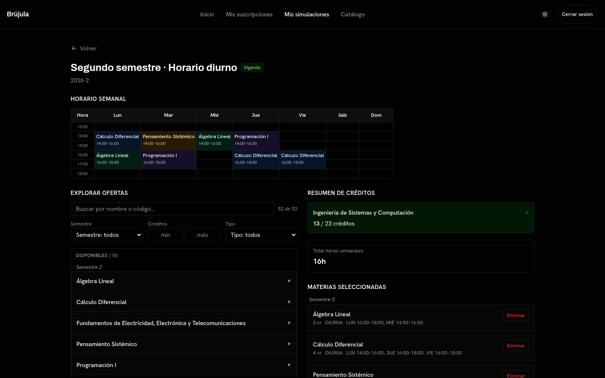
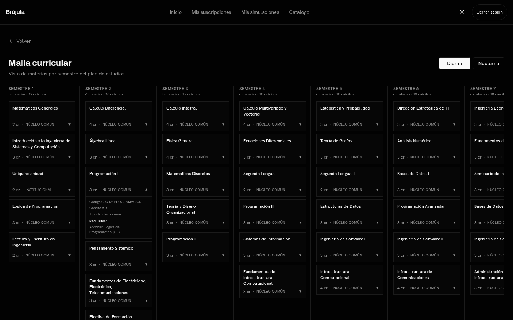
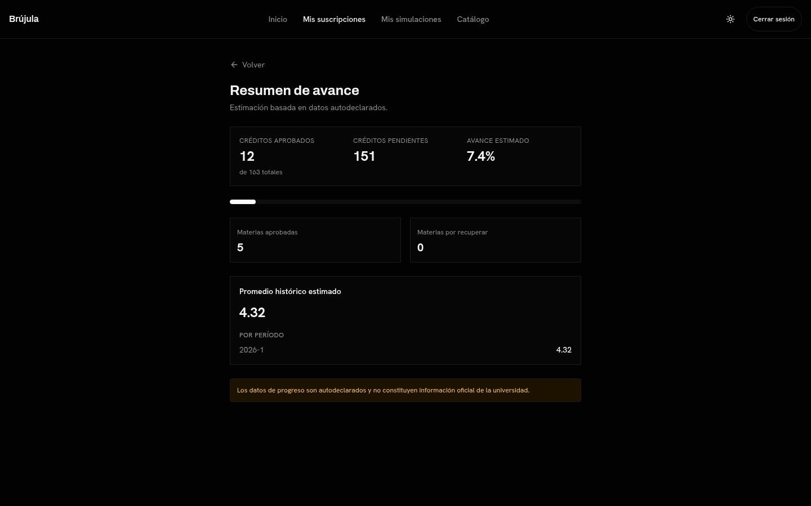
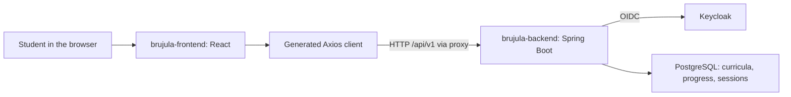

<!-- markdownlint-disable-next-line MD041 -->
<div align="center">

<h1>Brújula · Web App</h1>

<p><strong>Preview your next semester before enrolling at Universidad del Quindío.</strong></p>

<p>
<a href="https://github.com/diegnghtmr/brujula-frontend/actions/workflows/ci.yml"></a>


<a href="LICENSE"></a>
</p>

<p>
<a href="https://diegnghtmr.me/en/work/brujula/"><strong>Case study</strong></a> &bull;
<a href="#quick-start"><strong>Quick start</strong></a> &bull;
<a href="#architecture"><strong>Architecture</strong></a> &bull;
<a href="https://github.com/diegnghtmr/brujula-backend"><strong>Backend repo</strong></a>
</p>

</div>

<p align="center"></p>

A course can appear in the recommended semester without fitting your prerequisites or timetable. Brújula brings the curriculum, your self-reported progress, and the available sections into one planning workspace. Use it to compare schedules before registration; it does not certify grades or enroll you in classes.

## Features

- **Curriculum browser.** Explore programs and recommended semesters, and expand a course to see its credits and prerequisites.
- **Course attempts.** Record the outcome, period, and final grade of courses you have taken.
- **Progress summary.** See passed courses, credits earned, and an estimated average based on your declarations.
- **Semester simulation.** Choose offered sections and inspect detected prerequisite, credit-limit, and timetable conflicts.
- **Weekly timetable.** View selected sessions by day alongside credit and workload totals.

## Preview



Expand a curriculum course to see which subject must be passed first.



The progress summary uses self-reported course attempts; the account shown is fictional.

## Quick start

Use Node.js **24**, pnpm **11.0.8**, and Java for the OpenAPI Generator (use JDK **25** if also running the backend on the host). Start the dependencies and API using the [backend's host JVM setup](https://github.com/diegnghtmr/brujula-backend#quick-start).

```sh
git clone https://github.com/diegnghtmr/brujula-frontend.git
cd brujula-frontend
pnpm install --frozen-lockfile
pnpm api:generate
pnpm dev
```

Open <http://localhost:5173> and sign in through the local Keycloak realm. The generated client is not tracked; `pnpm api:generate` reads [the vendored OpenAPI contract](openapi/brujula-api.v1.yaml), and the post-generation script restores typed `content` fields on the paginated models that need them.

| Variable | Purpose | Default |
| --- | --- | --- |
| `VITE_API_BASE_URL` | Backend target in the environment of the Vite dev or preview process. It does not change the generated client's browser path. | `http://localhost:8080` |

Use `pnpm build` for the production bundle and `pnpm preview` to serve it locally. Vite's preview proxy also forwards the OAuth callback routes and strips `/api/v1` from API requests.

### Production deployment — API proxy requirement

The browser requests `/api/v1/*`, but Spring maps the generated controllers at paths such as `/me`, `/admin/*`, and `/staff/*`. A static deployment has no Vite proxy: configure the reverse proxy to strip `/api/v1` on API requests or mount Spring at that context path and configure the corresponding authentication routes. Without one of these setups, API requests return `404`.

## Architecture

Feature code consumes a generated Axios client rather than maintaining separate server route definitions. The API owns planning rules and exchanges the sign-in code with Keycloak; identity tokens stay server-side, and the browser receives a session cookie.



## Tech stack

| Layer | Technology |
| --- | --- |
| Application | React 19.2, TypeScript 6.0, React Router 7 |
| Build and UI | Vite 8, Tailwind CSS 4, Radix UI |
| API and state | OpenAPI Generator, Axios, TanStack Query, Zustand |
| Checks | ESLint, Vitest, Testing Library, Playwright and axe |

## Testing

```sh
pnpm lint
pnpm typecheck
pnpm test
```

[CI](.github/workflows/ci.yml) installs from the frozen lockfile, generates the client, then runs lint, type checking, and Vitest. [`ci/run.sh`](ci/run.sh) mirrors that gate locally. The opt-in real-stack job uses [`ci/run-e2e.sh`](ci/run-e2e.sh) with Docker, Chromium, and the companion backend; it exercises the application with Keycloak, PostgreSQL, and the API. `pnpm test:watch` and `pnpm test:e2e:ui` are interactive alternatives for their respective suites.

## Related repositories

- [brujula-backend](https://github.com/diegnghtmr/brujula-backend) — curriculum, progress, simulation, sign-in, and the source OpenAPI contract.

## License

Released under the [MIT License](LICENSE).
